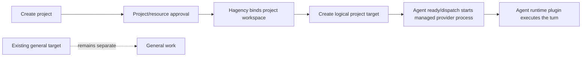

# Hagency plugin examples

Small plugin packages for the Hagency boundaries:

- `reference-harness` implements the generic `hagency.harness/v1` seam for the
  next agent-harness design.
- `herdr-runtime` implements `hagency.runtime/v1` as the current provider-backed agent runtime plugin.

The split is intentional: the harness is generic and view-only, while the runtime
adapter is the provider-specific execution side. No package contains Matrix,
operator, provider, or runner credentials.

## Host project and pane model

The generic target model is host-owned. Hagency creates or binds the project workspace and keeps the existing `general` target separate. The harness maps a project/agent to a project target; the agent runtime plugin receives that target through `harnessContext` and executes one turn. A plugin install or resource selection does not create a workspace or pane, and there is no new pane per message.

## Generic host project flow

The intended flow is provider-neutral:



1. Creating and approving a project creates the project identity. Its workspace is host-owned and is created or bound under the configured project location, not by the provider runtime executable.
2. The project gets a target separate from the existing `general` target. The general target is never retasked to the project.
3. The target materializes lazily when the agent becomes ready or receives its first dispatch. Creating a database project must not silently launch an unbounded background process.
4. A project message carries the project workspace and target. The harness prepares/observes the target; the agent runtime plugin sends the turn and reads the result.
5. Hagency settles the result, releases the workspace lease and asks the harness to release a managed target when its lifecycle allows it.
6. Later agents in the same project may reuse the project workspace according to policy, but never another project's target. Multiple live agents use distinct targets even when they share a project folder.

There is no new pane per message. The logical unit is a project/agent session; process work remains short-lived and host-supervised.

The example packages intentionally stop at the protocol seam: `reference-harness` validates prepare/release without launching a real target, and `herdr-runtime` performs the provider-specific execution without choosing a workspace or replacement target. Real project workspace and target provisioning belongs in the host platform slice.

## What each package proves

### Reference harness

`reference.harness` is a view-only harness. It accepts the host lifecycle messages
`initialize`, `snapshot`, `event`, `agent/prepare`, `agent/release`, and `shutdown`.
`agent/prepare` validates and echoes the template's opaque target and ownership;
it does not launch or prompt a process. Release is bound to the same allocation,
dispatch, and target.

The harness has no turn, approval, tool, usage, or task-completion authority. The
future agent shim/VM boundary belongs behind a separately qualified runtime
adapter; it should not be added to this fixture.

### Agent runtime package (`herdr-runtime`)

The `herdr-runtime` package is an agent runtime plugin for one provider. It consumes the target returned by `agent/prepare` through
`turn/start.params.harnessContext.target`, then invokes Herdr's `agent prompt` and
`agent read` commands. It does not choose a replacement target and does not own
approval, usage, task state, cleanup, or settlement.

Herdr remains responsible for its own provider login and credential home. The
adapter only receives the executable setting and the host-supplied harness target;
no credential value is checked in here.

## Build and smoke test

Run from this repository root:

```sh
cargo fmt --all --check
cargo build --workspace --locked
cargo test --workspace --locked
```

Build either package directly when preparing a package-local binary:

```sh
cargo build --release --locked --manifest-path packages/reference-harness/Cargo.toml
cargo build --release --locked --manifest-path packages/herdr-runtime/Cargo.toml
```

The package manifests live under `packages/`. The harness has no settings
credential surface. The runtime exposes only `herdr_bin` and the explicit
`herdr_env` opt-in; provider credentials stay outside this repository.

The package launchers are intentionally POSIX-only (`linux-x86_64` in the
manifests). They prefer a package-local release binary, then a package-local debug
binary, and finally the workspace binary, so GitHub package builds and local
linked-plugin smoke tests use the same entrypoint.
