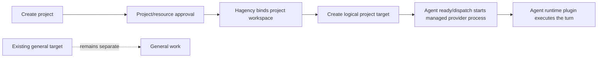

# Hagency plugin examples

Small plugin packages for the Hagency boundaries:

- `reference-harness` implements the generic `hagency.harness/v1` seam for the
  next agent-harness design.
- `herdr-runtime` implements `hagency.runtime/v1` as the current provider-backed agent runtime plugin.
- `herdr-core-runtime` implements `hagency.runtime/v1` on herdr-core (`hc`):
  one named terminal per agent, recreated in the dispatch workspace when gone,
  with a readiness probe so a stopped core defers dispatches instead of
  quarantining sessions.

The split is intentional: the harness is generic and view-only, while the runtime
adapter is the provider-specific execution side. No package contains Matrix,
operator, provider, or runner credentials.

## Host project and pane model

The generic target model is host-owned. Hagency creates or binds the project workspace and keeps the existing `general` target separate. The harness maps a project/agent to a project target; the agent runtime plugin receives that target through `harnessContext` and executes one turn. A plugin install or resource selection does not create a workspace or pane, and there is no new pane per message.

## Generic host project flow

The intended flow is provider-neutral:



1. Creating and approving a project creates the project identity. Its workspace is host-owned and is created or bound under the configured project location, not by the provider runtime executable.
2. The project gets a target separate from the existing `general` target. The general target is never retasked to the project.
3. The target materializes lazily when the agent becomes ready or receives its first dispatch. Creating a database project must not silently launch an unbounded background process.
4. A project message carries the project workspace and target. The harness prepares/observes the target; the agent runtime plugin sends the turn and reads the result.
5. Hagency settles the result, releases the workspace lease and asks the harness to release a managed target when its lifecycle allows it.
6. Later agents in the same project may reuse the project workspace according to policy, but never another project's target. Multiple live agents use distinct targets even when they share a project folder.

There is no new pane per message. The logical unit is a project/agent session; process work remains short-lived and host-supervised.

The example packages intentionally stop at the protocol seam: `reference-harness` validates prepare/release without launching a real target, and `herdr-runtime` performs the provider-specific execution without choosing a workspace or replacement target. Real project workspace and target provisioning belongs in the host platform slice.

## What each package proves

### Reference harness

`reference.harness` is a view-only harness. It accepts the host lifecycle messages
`initialize`, `snapshot`, `event`, `agent/prepare`, `agent/release`, and `shutdown`.
`agent/prepare` validates and echoes the template's opaque target and ownership;
it does not launch or prompt a process. Release is bound to the same allocation,
dispatch, and target.

The harness has no turn, approval, tool, usage, or task-completion authority. The
future agent shim/VM boundary belongs behind a separately qualified runtime
adapter; it should not be added to this fixture.

### Agent runtime package (`herdr-runtime`)

The `herdr-runtime` package is an agent runtime plugin for one provider. It consumes the target returned by `agent/prepare` through
`turn/start.params.harnessContext.target`, then invokes Herdr's `agent prompt` and
`agent read` commands. It does not choose a replacement target and does not own
approval, usage, task state, cleanup, or settlement.

Herdr remains responsible for its own provider login and credential home. The
adapter only receives the executable setting and the host-supplied harness target;
no credential value is checked in here.

The adapter follows the host runtime contract that every runtime plugin must meet:

- `turn/start` is answered `accepted` immediately; the turn runs on a worker
  thread so `turn/cancel` and `shutdown` are handled while Herdr works.
- While Herdr runs, a `progress` heartbeat is emitted every second. The host
  answers each request within a 2 s response bound and allows 60 s of silence
  between frames during a turn; the heartbeat keeps a long Herdr turn well
  inside that bound, and progress text is never taken as the result.
- `turn/cancel` stops the running Herdr command and settles the turn
  `interrupted`; `shutdown` and a closed stdin never leave a command running.
- The Hagency host starts plugins with an allowlisted environment: `PATH`, a
  non-secret `HOME` (the service user's), and the `HAGENCY_PLUGIN_*` values.
  Herdr needs a home to find its server socket, so the adapter uses the
  `herdr_home` setting, then the inherited `HOME`, then the home directory of
  the user running the plugin, in that order.
- The prompt sent to Herdr is the request in `inbox[].message.body` (mention
  links reduced to `@name`), not the envelope's generic `instruction`.
- `finalText` is the agent's answer cut from the `herdr agent read` screen
  (banner, prompt echo, input line and status footer removed). `usage` stays
  `null` (unknown), never zero. For a plugin runtime the host turns a completed
  turn's `finalText` into the room reply when the task has a Matrix route.
- The adapter does not advertise the `tool` capability: Herdr exposes pane
  control only, so the agent in the pane cannot reach Hagency task tools. A
  runtime that can relay tool requests advertises `tool` at `initialize`,
  receives `turn/start.tools`, and sends `tool/call`; the host runs each call
  once through its own task helper and answers `tool/result`.

## Build and smoke test

Run from this repository root:

```sh
cargo fmt --all --check
cargo build --workspace --locked
cargo test --workspace --locked
```

Build either package directly when preparing a package-local binary:

```sh
cargo build --release --locked --manifest-path packages/reference-harness/Cargo.toml
cargo build --release --locked --manifest-path packages/herdr-runtime/Cargo.toml
```

The package manifests live under `packages/`. The harness has no settings
credential surface. The runtime exposes `herdr_bin`, the explicit `herdr_env`
opt-in, and `herdr_home`; provider credentials stay outside this repository.

`packages/herdr-runtime/tests/conformance.rs` runs the built adapter against a
fake `herdr` with the host's environment shape (cleared, no `HOME`) and checks
immediate acceptance, the heartbeat bound, the clean answer, cancel, shutdown,
and refusal of a concurrent turn. New runtime plugins should carry the same
checks before qualification.

The package launchers are intentionally POSIX-only (`linux-x86_64` in the
manifests). They prefer a package-local release binary, then a package-local debug
binary, and finally the workspace binary, so GitHub package builds and local
linked-plugin smoke tests use the same entrypoint.

### Agent runtime package (`herdr-core-runtime`)

`herdr-core-runtime` runs the agent in [herdr-core](https://github.com/herdrdev/herdr-core)
(`hc`) instead of the Herdr TUI. One named `hc` terminal per agent target
(`harnessContext.target`):

- A turn checks the core's socket first and never autostarts a core: a core
  started by `hc` takes its caller's environment, and the plugin's is bare.
- A target that is gone (first use, or `finished` after a core restart or a
  reboot) is started again in the dispatch workspace with `agent_command`;
  a live target is reused, never retasked. No `--keep`, so a lost agent never
  comes back as a bare shell under the agent's name.
- A busy (`working`) or `blocked` agent is refused without typing into it.
- The turn types the `inbox` request with `hc send --wait` and keeps waiting
  (`hc wait`) until the agent's own OSC 7501 status reports `done`; `blocked`,
  `error` and exit are failures with their reason. The agent must report OSC
  7501 (omp does by default: `terminal.programStatus`).
- `turn/cancel` stops the wait and presses the agent's stop key
  (`hc interrupt`).
- The manifest declares a read-only `readiness` probe
  (`bin/herdr-core-runtime --probe`). A stopped core or a busy/blocked agent
  answers not ready, and Hagency requeues the dispatch as never started, so
  the session is never quarantined for it.

Settings: `hc_bin` and `agent_command` should be absolute paths (the host's
PATH and the core's environment may not include `~/.local/bin`), plus
`hc_session` and `hc_home`.

The core is the machine's service, not the plugin's. A systemd user unit with
linger keeps it across reboots:

```ini
# ~/.config/systemd/user/herdr-core.service
[Service]
Type=oneshot
RemainAfterExit=yes
Environment=PATH=%h/.local/bin:/usr/local/bin:/usr/bin:/bin
ExecStart=%h/.local/bin/herdr-core server start
ExecStop=%h/.local/bin/herdr-core server stop

[Install]
WantedBy=default.target
```

`systemctl --user enable --now herdr-core.service` (with `loginctl
enable-linger <user>`). After a reboot the next dispatch starts the agent
again in its workspace; with `agent_command = "omp --continue"` (the
default) omp resumes its previous conversation there. herdr-wake is not
needed, and it does not support omp.

`packages/herdr-core-runtime/tests/conformance.rs` runs the adapter against a
fake `hc`: creation in the workspace, reuse, check-in waits, refusals, the
no-core rule, cancel, restart after `finished`, and the probe.
